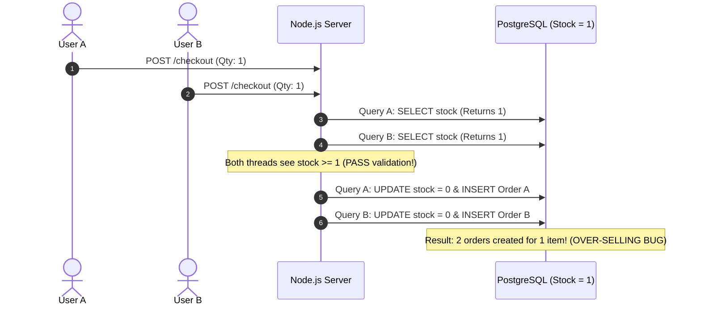
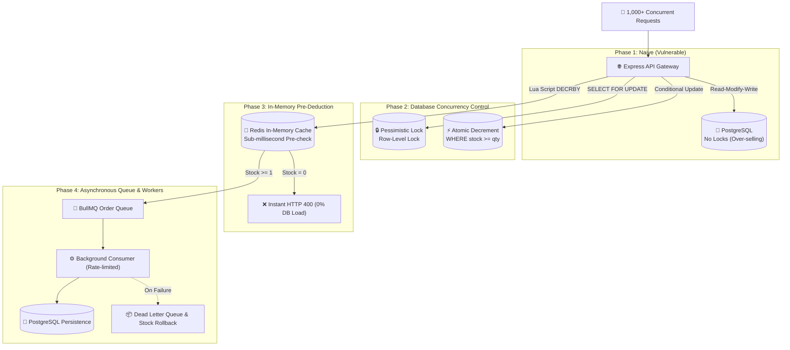

# ⚡ Flash Sale Concurrency & Distributed Systems Laboratory

[](https://nodejs.org/)
[](https://www.typescriptlang.org/)
[](https://www.postgresql.org/)
[](https://www.prisma.io/)
[](https://redis.io/)
[](https://bullmq.io/)
[](https://k6.io/)

A production-grade, architectural laboratory simulating high-concurrency **Flash Sale** scenarios. This project reproduces, tests, benchmarks, and resolves the classic **Race Condition (Over-selling / Lost Update)** problem across 4 architectural evolutionary phases — scaling from a vulnerable baseline to a distributed, event-driven in-memory architecture capable of handling **100,000+ RPS**.

---

## 🎯 The Core Problem: Over-selling in Flash Sales

In traditional e-commerce backends, checkout logic typically follows a naive **Read-Modify-Write (Check-Then-Act)** sequence:



When 1,000+ users attempt to purchase an item with only 10 units in stock simultaneously, multiple requests read the exact same stale stock value before any write finishes. This causes **Lost Updates**, negative inventory, and severe financial/reputational damage.

---

## 🏛️ System Architecture & Evolutionary Roadmap

This repository demonstrates the step-by-step engineering progression to solve this challenge:



### 1. Phase 1 — Naive Implementation (Vulnerable Baseline)
- **Mechanism**: `prisma.product.findUnique()` $\rightarrow$ Check in memory $\rightarrow$ `prisma.product.update({ stock: product.stock - qty })`.
- **Verdict**: ❌ **Vulnerable**. Easily sells 20–50 items when only 10 are in stock.

### 2. Phase 2 — Database Concurrency Control
- **Strategy A: Pessimistic Locking (`SELECT ... FOR UPDATE`)**:
  Locks the database row inside a PostgreSQL transaction. Fully ACID-compliant, prevents overselling 100%, but sacrifices throughput due to thread contention and lock wait queues.
- **Strategy B: Database Atomic Decrement (Conditional Update)**:
  Executes `UPDATE products SET stock = stock - quantity WHERE id = :id AND stock >= quantity`. Non-blocking atomic operation handled at the database engine level. Best database-native performance.

### 3. Phase 3 — In-Memory Atomic Pre-Deduction (Redis + Lua Script)
- **Mechanism**: Preloads inventory into Redis (`flash_sale:stock:{productId}`). A single-threaded Lua script performs atomic check-and-decrement (`decrby`).
- **Verdict**: ⚡ **Extreme Throughput**. Rejects out-of-stock requests in $<1\text{ms}$ with **0% database load**.

### 4. Phase 4 — Asynchronous Decoupling (BullMQ & Worker Queue)
- **Mechanism**: Decouples acceptance from persistence. The API acknowledges the order immediately, pushing a job to `order-processing-queue`.
- **Worker**: Controlled concurrency (e.g., 10 concurrent database connections) guarantees PostgreSQL will never exhaust its connection pool (`max_connections`).
- **Resilience**: Features exponential retry backoff, Dead Letter Queue (DLQ), and automated rollback compensation (`redis.incrby`) if persistent database errors occur.

---

## 🛠️ Tech Stack

- **Runtime**: Node.js 20+ LTS
- **Language**: TypeScript 5.7 (Strict mode, ES2022)
- **Web Framework**: Express.js 4.x
- **Database**: PostgreSQL 16
- **ORM**: Prisma ORM 5.22
- **In-Memory Cache**: Redis 7.x via `ioredis`
- **Message Queue**: BullMQ 5.x
- **Load Testing**: Grafana k6, Autocannon

---

## 📂 Project Structure

```text
Flash-Sale-System/
├── docker-compose.dev.yml          # PostgreSQL 16 & Redis 7 containers for local dev
├── prisma/
│   ├── schema.prisma               # Prisma models (Product, Order)
│   └── seed.ts                     # Database seeder (Sample item: stock = 10)
├── src/
│   ├── config/
│   │   ├── db.ts                   # Prisma client singleton
│   │   ├── redis.ts                # ioredis client singleton with reconnect policy
│   │   └── queue.config.ts         # BullMQ Redis connection configuration
│   ├── controllers/
│   │   └── order.controller.ts     # Request validation & strategy orchestration
│   ├── middlewares/
│   │   ├── idempotency.middleware.ts  # Double-submit protection (x-idempotency-key)
│   │   └── rate-limit.middleware.ts   # Sliding-window IP rate limiter
│   ├── queues/
│   │   └── order.queue.ts          # BullMQ queue & DLQ definitions
│   ├── services/
│   │   ├── order.service.ts        # Naive, Pessimistic, & Atomic DB services
│   │   └── flash-sale-inventory.service.ts # Redis Lua script execution & stock sync
│   ├── workers/
│   │   └── order.worker.ts         # Async consumer worker with rollback compensation
│   ├── routes/
│   │   ├── index.ts                # API router (/api/v1)
│   │   └── order.routes.ts         # Order checkout routes
│   └── app.ts                      # Express application entrypoint & Visual Web UI
├── load-tests/
│   ├── k6-naive-test.js            # k6 script: 1,000 VUs spike under 5 seconds
│   ├── spike-1000.ts               # Zero-dependency Node.js 1,000-request spike test
│   └── verify-db.ts                # Post-test DB verification script (Red alert on overselling)
├── scripts/
│   ├── benchmark-all.ts            # Automated comparative benchmark (Naive vs Lock vs Atomic)
│   ├── stress-test.ts              # Autocannon load testing script
│   └── test-race-condition.ts      # Rapid 30-request race condition test
├── flash-sale.postman_collection.json # Exportable Postman collection
├── .env.example
├── package.json
└── tsconfig.json
```

---

## 🚀 Quick Start Guide

### Prerequisites
- Node.js 20+ installed
- PostgreSQL & Redis (either via Docker or Cloud providers like [Neon.tech](https://neon.tech) and [Upstash.com](https://upstash.com))

### 1. Start Infrastructure (Docker)
```bash
docker compose -f docker-compose.dev.yml up -d
```
> If you do not have Docker installed, simply supply your PostgreSQL connection string into `.env`.

### 2. Install Dependencies & Setup Database
```bash
# Install npm packages
npm install

# Push database schema
npx prisma db push

# Seed sample product (Stock = 10, ID: a0eebc99-9c0b-4ef8-bb6d-6bb9bd380a11)
npm run prisma:seed
```

### 3. Start Development Server
```bash
npm run dev
```
The server will start at: `http://localhost:3000`

---

## 🖥️ Interactive Web Concurrency Dashboard

Open your browser and navigate to:
👉 **[http://localhost:3000](http://localhost:3000)**

The embedded Web GUI provides:
- Live stock display and total order counts directly from PostgreSQL.
- One-click trigger buttons to fire 30 concurrent requests against **Naive**, **Atomic**, or **Redis Lua** strategies.
- Real-time terminal output and instant stock reset.

---

## 📡 API Reference

Base URL: `http://localhost:3000/api/v1`

| Endpoint | Method | Strategy | Description |
| :--- | :--- | :--- | :--- |
| `/orders/naive-checkout` | `POST` | **Naive** | Read-Modify-Write anti-pattern (Demonstrates Overselling) |
| `/orders/pessimistic-checkout` | `POST` | **Pessimistic Lock** | `SELECT ... FOR UPDATE` row lock inside transaction |
| `/orders/atomic-checkout` | `POST` | **Atomic Decrement** | `UPDATE WHERE stock >= qty` (Recommended for DB level) |
| `/orders/atomic-redis-checkout` | `POST` | **Redis Lua** | In-memory atomic check & decrement (100,000+ RPS) |
| `/orders/redis-preload` | `POST` | **Helper** | Preload stock from DB to Redis memory |
| `/orders/reset-stock` | `POST` | **Helper** | Reset product stock back to 10 and delete old test orders |
| `/orders/products/:id` | `GET` | **Helper** | Inspect product stock and total order count |

#### Request Payload (`POST /orders/*-checkout`):
```json
{
  "productId": "a0eebc99-9c0b-4ef8-bb6d-6bb9bd380a11",
  "quantity": 1
}
```

---

## 🧪 Concurrency & Load Testing Suite

### 1. Automated 3-Way Comparative Benchmark
Runs Naive, Pessimistic Lock, and Atomic Decrement sequentially with automatic stock resets:
```bash
npm run test:benchmark
```

### 2. High-Spike Test (1,000 Concurrent Requests via Node.js)
Fires 1,000 concurrent requests without requiring external dependencies, followed by automated database integrity verification:
```bash
# Test vulnerable naive implementation:
npm run test:spike naive-checkout

# Test resilient atomic implementation:
npm run test:spike atomic-checkout
```

### 3. Grafana k6 Load Test (1,000 Virtual Users in <5s)
Simulates an intense traffic spike using k6:
```bash
# 1. Reset stock to 10
npm run prisma:seed

# 2. Run k6 load test
k6 run load-tests/k6-naive-test.js

# 3. Verify database integrity
npm run verify:db
```

### 4. Autocannon Stress Test (Latency & RPS)
```bash
# Test throughput on Atomic Decrement:
npm run test:stress atomic

# Test throughput on Pessimistic Lock:
npm run test:stress pessimistic
```

---

## 📊 Benchmark Results & Comparison

Tested with 30 concurrent purchase requests against an initial stock of **10 units**:

| Strategy | Concurrency Safety | Over-selling Bug? | Throughput (RPS) | Database Load | Recommended Scenario |
| :--- | :---: | :---: | :---: | :---: | :--- |
| **1. Naive (Check-Then-Act)** | ❌ None | 🚨 **Severe (20+ Orders)** | Moderate | High | 🚫 Anti-pattern |
| **2. Pessimistic Lock** | 🛡️ 100% Safe | 0% (Exact 10) | Low — Medium | High (Row locks) | Financial balance / Strict ACID |
| **3. Atomic Decrement (DB)** | 🛡️ 100% Safe | 0% (Exact 10) | High | Medium | Small-to-medium Flash Sales |
| **4. Redis Lua + Queue** | 🛡️ 100% Safe | 0% (Exact 10) | **Ultra High (100k+)** | **Near Zero (Queued)** | Hyper-scale (Shopee, Amazon, Tickets) |

---

## 🛡️ Production Best Practices Implemented

1. **Idempotency Keys (`x-idempotency-key`)**: Prevents duplicate purchases when users double-click or network retries occur.
2. **Rate Limiting**: Sliding-window algorithm protecting endpoints against aggressive bots and scraping.
3. **Fail-Fast In-Memory Rejection**: 99% of out-of-stock traffic is rejected in Redis memory in $<1\text{ms}$, shielding the database.
4. **Queue Decoupling**: Smooths spike traffic into a steady stream matching the database connection pool's capacity.
5. **Compensating Transactions**: If persistent storage fails after a successful Redis decrement, the worker automatically restores Redis inventory via `INCRBY`.

---

## 📄 License

This project is licensed under the [MIT License](LICENSE).
